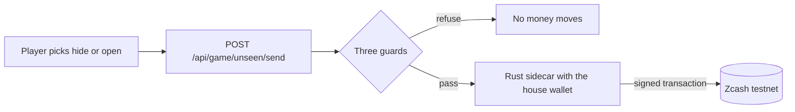

# Zarcade

Zarcade is an arcade that teaches Zcash privacy. Every machine is a small game
that moves real practice money on the Zcash test network. Built for the
Zecathon, Track 05 Wildcard.

## The ask

You are asked to send a small payment. You pick: hide it, or send it in the
open. Then you see exactly what a stranger can see afterwards. You install
nothing and hold no keys.

## Proof it is real

Every round broadcasts a real transaction to the Zcash testnet. Two early
ones, both mined on 2026-10-11:

- Hidden: [`952a1959…f3299c77`](https://testnet.zecblock.com/tx/952a1959f26c0f405e52de225239cb51bc0bb0696357f669d7449480f3299c77)
  in block 4,488,884. The explorer labels it a fully private Ironwood pool
  transaction: all amounts, senders and recipients encrypted.[^1]
- Open: [`7ffa8ea6…45bb914f2`](https://testnet.zecblock.com/tx/7ffa8ea6cab7dd1ae9e9558fa08e8f7a72b1c22dde423754eda69d245bb914f2)
  in block 4,488,905. The explorer gives it a privacy score of 0 out of 100
  and names the amount and the recipient.[^1]

## What you see


## How a round works

1. You pick hide or open.
2. The house wallet sends 1,000 zatoshis of testnet money. The amount and the
   destination are fixed on the server, never by the player.
3. Hidden: the payment lands in the shielded pool. Open: it lands at a
   transparent address, in full public view.
4. You get the receipt: the transaction id and, once it is mined, the block.
5. The next player can go right away. The pot is split into confirmed small
   coins ahead of time, so nobody waits for one large coin to settle.

## Hide versus open, side by side

| | Hidden | Open |
| --- | --- | --- |
| Explorer shows the amount | No | Yes |
| Explorer shows the sender | No | Yes |
| Explorer shows the recipient | No | Yes |
| A private note can ride along | Yes | No. The network refuses memos on transparent payments |
| The explorer's own verdict | "Fully private… all amounts, senders, and recipients are encrypted" | Privacy score 0/100 |

## How it is built



The front end is Next.js 16 with React 19 and TypeScript. The wallet is a
Rust sidecar built on axum and librustzcash. Its seed never leaves
`sidecar/data/`, and it listens on `127.0.0.1:9070`, an address only the
machine itself can reach.

Exactly one route can move money: `POST /api/game/unseen/send`. It accepts
`{"choice": "hide"}` or `{"choice": "open"}` and nothing else. Unexpected
fields are refused, not ignored. Three guards run before the wallet is
touched: a global pause, a per-visitor hourly share, and a daily ceiling for
the whole arcade.

Real numbers, measured on this machine:[^2]

- Fees follow ZIP-317: 5,000 zatoshis per logical action.
- One zero-knowledge proof takes about 12 seconds to build.
- A full round takes 21 to 29 seconds. Confirmation waits ran 34 to 99
  seconds against blocks that average 23.6 seconds.
- 76 tests pin the money rules down.

The house wallet at the moment of writing (`GET /api/house/status`, address
fields trimmed):

```json
{
  "ok": true,
  "refilling": false,
  "network": "testnet",
  "syncedTo": 4492642,
  "zatoshis": 11428000,
  "taz": "0.11428000",
  "spendableZatoshis": 11412000,
  "pendingChangeZatoshis": 0,
  "transparentZatoshis": 16000,
  "readyForRound": true
}
```

<details>
<summary>Field note: the faucet that paid on a dead chain</summary>

On 2026-10-04 the public testnet activated NU7 at height 4,465,026. The
well-known faucets kept paying on the abandoned pre-NU7 fork, so their coins
are invisible to a wallet on the canonical chain. We claimed a deposit that,
as far as our sidecar was concerned, never existed. The fix was finding a
faucet on the living chain and re-funding. It was logged as D-027 in
`DECISIONS.md` before any code changed.

</details>

<details>
<summary>Field note: the bug our own audit caught</summary>

The motion question remembers your choice, but a fresh page load ignored it.
React 19 refuses to patch attribute mismatches found at hydration, so the
server-rendered value stayed stuck. It reproduced in the production build, not
just in dev. The fix follows the pattern Next.js documents: an inline script
applies the saved choice to the page before the first paint. An earlier note
had called the warning harmless. That note was wrong, and the correction is
public in `ROADMAP.md` (D-051).

</details>

<details>
<summary>Field note: the dust floor</summary>

A wallet can hold coins it will never spend. Anything at or below the ZIP-317
marginal fee of 5,000 zatoshis is treated as dust and deliberately left out of
the balance. We found this by reading the wallet database directly when the
numbers did not add up (`RESEARCH.md`, item I5). It is why the pot split
refuses to create any coin at or below the dust floor: a pot of dust is an
arcade nobody can play.

</details>

## Run it locally

You need Node.js 20.9 or newer and a stable Rust toolchain. On Windows, also
the Visual Studio Build Tools with the C++ workload.

1. Start the house wallet. It has to run before anything can move money.

   ```powershell
   cd sidecar
   cargo run
   ```

   The first run creates the wallet and scans the chain from a pinned
   birthday height. Wait for `initial sync complete up to height …` before
   continuing.

2. Fund it with free testnet coins from the Zakura NU7 faucet
   (https://zakura.com/nu7), sent to the deposit address the sidecar prints.
   One warning, learned the hard way: faucets paying on the abandoned pre-NU7
   fork show money that does not exist on the canonical chain.

3. Before a play session, split the pot so players can follow each other:

   ```powershell
   powershell -File sidecar\split-pot.ps1
   ```

   Allow about eight minutes for the default 40 coins.

4. Start the site.

   ```powershell
   npm install
   npm run dev
   ```

   Open the printed URL, then load `/api/house/status` in the browser. `"ok":
   true` means the site can see the wallet.

Full operating details, session checklist and troubleshooting:
[OPERATING.md](OPERATING.md).

## The look

Gold means lit and public. Cool shadow means sealed and private. There is no
red and no green anywhere, because nothing here is graded by colour. The
Watcher, the hooded figure on every screen, stands for everyone who can read
the public record. Every entrance asks "Motion: more or less?" and remembers
the answer. Type: Syne for display, Space Grotesk for prose, Geist Mono for
chain data. The full system is written down in [STYLEGUIDE.md](STYLEGUIDE.md).

## Limits

- Testnet only. No real money, ever.
- One machine is live. Four cabinets are dark and the floor says so: The
  Proof Puzzle, The Double-Spend Heist, The Auditor's Key, The Vault Run.
- One confirmation cannot be skipped, so round pacing depends on the chain.
- The first sync is slow and the pot split is slower. Both are stated costs,
  not surprises.
- The house wallet serves one operator. It is not multi-tenant production
  software.

## How this was built

One owner, one AI assistant, and a written agreement:
the owner decides, the assistant advises and drafts, and nothing is built
until it is written down and approved. Every decision, D-001 through D-054,
is logged in [DECISIONS.md](DECISIONS.md) with its why, its alternatives and
who decided. Open questions stay visible until answered. The agreement itself
is [AGREEMENT.md](AGREEMENT.md). The repository lives at
github.com/Valorian0108/zarcade.

## Repo map

```
app/           the site: door (/), floor (/arcade), machine (/games/unseen), API routes
components/    the game frame, the Watcher, the door and floor, the motion question
lib/games.ts   the cabinet list, single source of truth
lib/zcash/     the bridge from the site to the sidecar
sidecar/       Rust: the house wallet (its data/ folder is secret and gitignored)
assets/        screenshots for this README
OPERATING.md   running the arcade: pot split, session checklist, troubleshooting
AGREEMENT.md   how owner and assistant work together
DECISIONS.md   every decision with its why
ROADMAP.md     phases and the exact state of each step
STYLEGUIDE.md  the design system
README-PLAN.md the plan this README was written from
VISION.md, SCOPE.md, ARCHITECTURE.md, OUTLINE.md, RESEARCH.md, BRIEF.md
```

## License

MIT. See [LICENSE](LICENSE).

[^1]: Explorer labels and privacy scores from testnet.zecblock.com, fetched
     2026-10-11.
[^2]: Measured during the B4 and B5 build phases on 2026-10-11. Details in
     `RESEARCH.md`, items I1, I2, I5 and I7.
